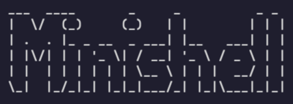

_This project has been created as part of the 42 curriculum by jenlee, yolim._

# Welcome to Minishell



## Description

Minishell is a 42-school team project implementing a basic POSIX-compliant shell in C, mimicking Bash Version 5.1.16. It provides an interactive command-line interpreter supporting command execution, input parsing, redirections, pipes, environment variables, built-in commands, signal handling, logical operators (`&&`, `||`) with parentheses, and current-directory `*` wildcards.

**Developed in collaboration with [ABCSoup](https://github.com/DaSoupOfABC)**

---

## Features

- **Prompt display** — Displays an interactive prompt while waiting for commands
- **Command history** — Navigate and reuse previous commands using arrow keys
- **Command execution** — Search and launch executables from `PATH` or using relative/absolute paths
- **Quoting**
  - Single quotes `'` prevent all meta-character interpretation
  - Double quotes `"` prevent meta-character interpretation except for `$` (variable expansion)
- **Redirections** — Input (`<`), output (`>`), append (`>>`), and here-document (`<<`)
- **Pipes** — Chain commands with `|`
- **Environment & special variables** — `$VARIABLE_NAME` and `$?`
- **Signal handling** — `Ctrl+C`, `Ctrl+D`, and `Ctrl+\`
- **Built-in commands** — `echo -n`, `cd`, `pwd`, `export`, `unset`, `env`, and `exit`
- **Bonus** — Logical operators `&&` and `||` with parentheses `()`, and `*` wildcard expansion

---

## Architecture & Workflow

Each command line passes through five stages in [`src/main.c`](src/main.c):

1. **Input & History** (`read_and_prepare_input`) — Reads interactive input with `readline` (or `get_next_line` non-interactively), syncs `SIGINT` (`$? = 130`), and records history.
2. **Lexing & Expansion** (`tokenize`) — Rejects unclosed quotes, splits operators/words, and expands `~`, `$VAR`, and `$?` while preserving quoted whitespace/wildcards.
3. **AST Parsing** (`parse`) — Builds a binary AST with Bash precedence (`&&`/`||` < `|` < `()`/commands), handling word splitting, `*` wildcards, and redirection lists.
4. **Heredoc Preprocessing** (`heredocs`) — Reads all `<<` heredocs into pipes ahead of execution with `Ctrl+C` isolation and conditional `$` expansion.
5. **Execution & Cleanup** (`execute_ast`) — Runs builtins in-process (with FD backup/restore) and external commands, pipes, and subshells in forked children, then frees per-command AST/tokens.

For a full breakdown with struct and function references, see [WORKFLOW.md](WORKFLOW.md).

---

## Instructions

### Requirements

- **Compiler:** `cc` (GCC or Clang)
- **Libraries:** GNU Readline (`libreadline-dev` on Ubuntu/Debian, `readline` on macOS via Homebrew)
- **OS:** POSIX-compliant system (Linux/macOS)

### Compilation & Execution

```bash
make
./minishell
```

Cleaning rules:
```bash
make clean      # Remove object files
make fclean     # Remove object files and binary
make re         # Rebuild everything
```

---

## Resources

- [GNU Bash Manual](https://www.gnu.org/software/bash/manual/bash.html)
- [GNU Readline Library Documentation](https://tiswww.case.edu/php/chet/readline/rltop.html)
- [42 Minishell Tester](https://github.com/zstenger93/42_minishell_tester)
- **AI Usage:** AI tools were used during post-development review and evaluation preparation to audit edge cases against Bash 5.1.16 (parser syntax checks, redirection ordering, heredoc handling, and Norminette compliance).
